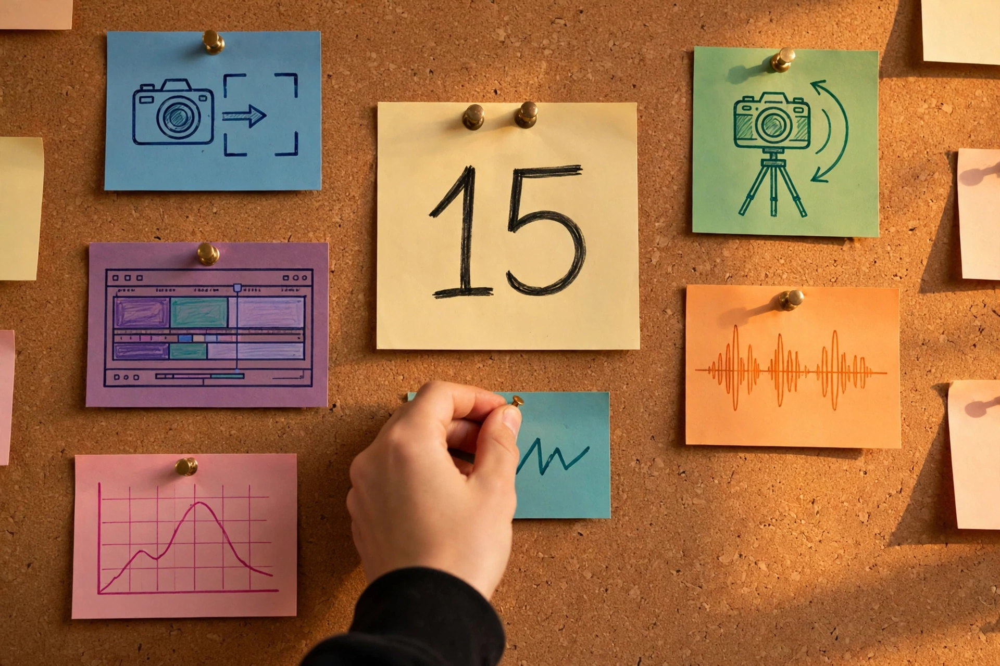

# 第 1 章：一部片子，十五个决定

为什么别人的 15 秒 TikTok 像电影，你的像监控录像？差的不是手机——是按"录制"前，他脑子里开了 15 个会，你一个没开。

[配图：15 个决定的地图]

## Introduction：地图

先回答第一部留下的地基，再看第二部多了什么。

**照片 = 数光子**：1 个瞬间，8 个决定（光圈/快门/ISO/焦段/角度/构图/光线/色彩）。第一部讲完了。

**视频 = 24 张照片/秒 + 声音 + 故事**。眼睛有"视觉暂留"：24 张照片飞快地连起来，脑子就以为是连续的。所以：

- **导演 = 摄影师 + 时间 + 声音 + 故事**
  - 摄影师：每个镜头的 8 个决定（老朋友，不用重学）
  - 时间：镜头多长、什么时候切（新）
  - 声音：对白/音乐/音效/静默（新）
  - 故事：为什么是这个顺序（新）

**15 个决定 = 8（摄影）+ 7（视频）**。8 个老朋友快速检阅，7 个新决定这章细讲。从第 2 章起，一章拧一个。

## 老朋友检阅：摄影的 8 个决定（30 秒过一遍）

每个镜头都是一张照片，所以每个镜头都要开这 8 个会：光圈（虚化）、快门（凝固/流动）、ISO（夜景放大器）、焦段（望远镜）、角度（站哪）、构图（怎么摆）、光线（从哪来）、色彩（暖冷）。

> 📖 前置知识：8 个决定的完整版 → 《AI 摄影师：用文字拍照》第 1 章 [站内直达](https://ezcat207.github.io/ai-photography/#c=01)

导演和摄影师的区别：摄影师开 1 次会按 1 次快门，导演开 240 次会（15 秒 × 16 个决定？不，是每个镜头的 8 个 + 7 个视频决定）还不许变。

## 新决定 1：运镜——让镜头动起来 📍时间

**是什么**：镜头自己会动。六种基本运镜：

**13 岁版**：
- **推**：镜头往前走，靠近——"走近看"，强调、紧张。
- **拉**：往后退， reveal 全场——"退后看"，交代、孤独。
- **摇**：原地左右转头——"找人"，展示环境。
- **移**：横着走——"跟着走"，跟拍、游览。
- **跟**：跟着人跑——"一起跑"，动作、追逐。
- **升降**：上下飞——"上帝视角"，开场、结尾。

**拿 15 秒短视频来说**：运镜是"语气"。推近 = 悄悄话，拉远 = 大喊，摇 = 环顾。同一句话，不同语气，意思全变。

## 新决定 2：时长与节奏——什么时候切 📍时间

**是什么**：一个镜头放几秒？什么时候切下一个？

**13 岁版**：切快了晕（动作片 1 秒一切），切慢了困（文艺片 10 秒不切）。15 秒短视频，切 5–8 个镜头是甜点——平均 2–3 秒一个，符合刷手机的耐心。

**拿 15 秒短视频来说**：前 3 秒必须出钩子（最炸的画面先放），不然手指一划，你就没了。节奏 = 观众的耐心管理。

## 新决定 3：转场——镜头的标点符号 📍时间

**是什么**：两个镜头之间怎么接。

**13 岁版**：
- **硬切**：直接切，最常用——句号。
- **淡入/淡出**：黑场过渡——省略号，时间过去了。
- **闪白**：白闪一下——惊叹号，回忆、冲击。
- **匹配剪辑**：开门 → 关门，形状/动作接上——双关，导演在炫技。

**拿 15 秒短视频来说**：15 秒里，硬切够用了。转场是标点，不是烟花——标点太多，句子就没法读了。

## 新决定 4：声音——画面的一半 📍声音

**是什么**：对白、音乐、音效、静默。

**13 岁版**：关掉声音看恐怖片，一点不恐怖——情绪少一半。音乐定调子（暖/燃/丧），音效定真实（脚步声、关门声），静默定张力（突然没声，观众屏住呼吸）。

**拿 15 秒短视频来说**：TikTok 的一半是 BGM。选对 BGM，播放量翻倍——声音是流量的另一半。

## 新决定 5：故事——起承转合 📍故事

**是什么**：为什么是这个顺序。15 秒也要有：钩子 → 发展 → 反转/结尾。

**13 岁版**：
- **钩子**（前 3 秒）：最炸的画面/一句话悬念，不许铺垫。
- **发展**（中间 9 秒）：把事情讲清楚。
- **反转/结尾**（最后 3 秒）：意料之外，或一句让人点赞的话。

**拿 15 秒短视频来说**：没有故事的视频就是屏保——再好看也看 10 秒。故事是"看完"的理由。

## 新决定 6：一致性——AI 时代最难的一课 📍AI

**是什么**：1000 帧里，同一张脸、同一件衣服、同一只猫，不能变。

**13 岁版**：这是 AI 视频最难的，也是导演和"AI 玩家"的分水岭。摄影师按 1 次快门，导演按 240 次还不许变——AI 每次生成都是"重新画"，脸每次都可能不一样。

**解法预告**（第 7 章细讲）：角色锁定（同一张参考图）、分段生成（一次只生成一个镜头）、台词本（外貌描述一字不差）。

**拿 15 秒短视频来说**：你的主角第 1 秒长这样，第 10 秒变了个人——观众出戏，完播率崩盘。一致性 = 观众的信任。

## 新决定 7：分镜与组装——导演的施工图 📍组装

**是什么**：开拍前，先画分镜：每个镜头写清"画面 + 运镜 + 时长 + 声音 + 台词"。拍完（或生成完），按分镜组装。

**13 岁版**：分镜是导演的施工图。没有施工图就盖楼，盖出来就是危房。15 秒短视频的分镜表，5–8 行就够。

**拿 15 秒短视频来说**：先写分镜表，再拍/生成，最后组装。顺序反了（先拍一堆素材再想故事），剪辑时会哭。

## 小结：导演难在哪

摄影师：1 个瞬间，8 个决定，按 1 次快门。
导演：N 个瞬间 × 8 个决定 + 运镜 + 节奏 + 转场 + 声音 + 故事 + 一致性，按 240 次快门还不许变。

难，但地图是一样的：光 + 镜头 + 你，再加上时间、声音、故事。

## 桥：翻译成 AI 视频提示词

AI 视频提示词 = 摄影提示词 + 运镜 + 时长：

- "女孩在奶茶店，背景虚化" + "镜头缓慢推近" + "3 秒"
- "滑板少年腾空" + "跟随拍摄" + "2 秒"
- "夜景街道" + "航拍上升" + "5 秒，蓝调时刻"

公式：**画面（8 个决定）+ 运镜 + 时长 + 声音说明**。

## 作业：填空题（明天交）

"我要拍一条____（15 秒短视频），讲____（什么故事，一句话），第 1 个镜头是____（画面+运镜），打算____（几秒切一次），配____（什么音乐/音效）。"

**示范**："我要拍一条 15 秒短视频，讲'我家猫的复仇'，第 1 个镜头是'猫盯着镜头，缓慢推近'，打算'2 秒切一次'，配'悬疑 BGM + 猫叫'。"

交：填好的句子（分镜表第 1 行）。明天课上先看分镜，再开新章。

## 后路

15 个决定，你认全了。从第 2 章起，我们单拧"运镜"：让镜头动起来的 6 种语气。
