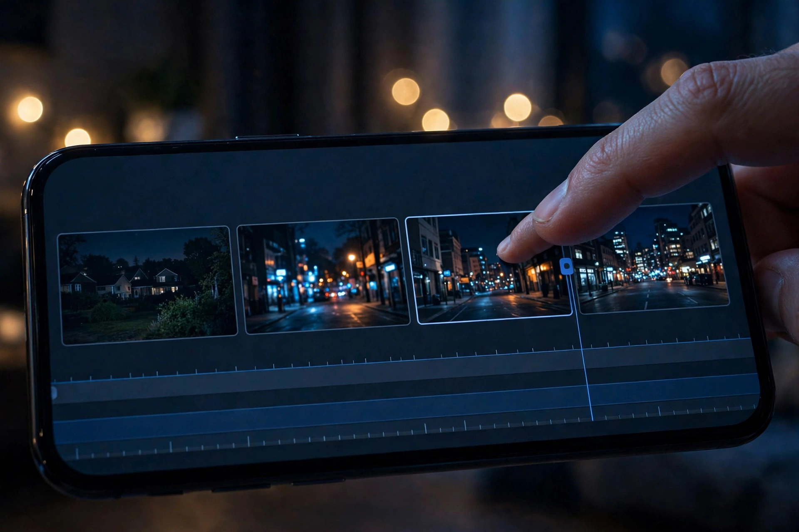

# 第 3 章：时长与节奏——什么时候切

**地图定位**：时间 · 一个镜头放几秒。

你的视频为什么看到第 5 秒就想划走？不是内容不行，是节奏错了——切太慢，观众困了；切太快，观众晕了。

看这张图：剪辑时间线上排着几个片段，手指正要把一个剪短。导演每天干的最多的活，就是这个动作——决定每个镜头活几秒。

## 时长与节奏是什么

**一句话**：每个镜头多长，什么时候切——它是观众的"耐心管理"。

**13 岁版**：

- **切快了晕**：动作片 1 秒一切，肾上腺素拉满，但看 1 分钟就累。
- **切慢了困**：文艺片 10 秒不切，有味道，但刷手机的人没这个耐心。
- **甜点**：15 秒短视频，切 5–8 个镜头——平均 2–3 秒一个。这是刷手机时代的"心跳频率"。
- **前 3 秒定生死**：第一个镜头必须是最炸的画面或一句话悬念。不许铺垫，铺垫就是自杀。

**两个冷知识**：
1. 节奏不是越快越好，是"快慢搭配"。全程快 = 吵，全程慢 = 困——像音乐一样，要有鼓点有休止。
2. 切点要落在"动作"或"情绪"的峰值上，不要落在中间——切在半截话上，观众难受。

## 拿 15 秒短视频来说

你的 15 秒，试试这个节奏模板：0–3 秒钩子（最炸）→ 3–12 秒发展（3 个镜头，每 3 秒切）→ 12–15 秒反转（1 个镜头，收住）。先套模板，再谈风格。

## Prompt 教学：怎么让 AI 听时长

AI 视频工具一般按"秒"生成——prompt 里写清时长，生成完再按分镜剪：

**范例 1（短镜头，钩子）**：
- 中文：一只猫的脸部特写，眼睛突然睁大，镜头静止，2 秒，悬念感
- English: Extreme close-up of a cat's face, eyes suddenly widening, static camera, 2 seconds, suspenseful

**范例 2（长镜头，情绪）**：
- 中文：少年在天台上看日落，镜头缓慢拉远，5 秒，安静，留白
- English: A teenage boy watching sunset on a rooftop, camera slowly pulling back, 5 seconds, quiet, breathing room

**关键**：时长写进 prompt（"2 秒""5 秒"），但别指望 AI 分毫不差——生成完在剪辑里精确到帧。Prompt 定大概，剪辑定精确。

## 可复现实验

拿你手机里任意一条 30 秒视频，剪成 15 秒：只留 6 个镜头，每个 2–3 秒。对比原版：信息少了，但完播率感觉变高了？节奏这章，动手一次就懂。

## 翻车预警

- **铺垫翻车**：前 3 秒还在"大家好我是…"——观众已经划走了。钩子先行，自我介绍滚到最后。
- **匀速翻车**：每个镜头都是 3 秒，节奏像心电图拉直线——试试 2-2-4-2-5，有长有短才有呼吸。

## 作业：填空题（明天交）

"我的 15 秒短视频，节奏是____（几个镜头），第 1 个镜头____（几秒，什么画面），因为____（为什么它能留住人）。"

**示范**："我的 15 秒短视频，节奏是 6 个镜头，第 1 个镜头 2 秒——猫的脸突然怼到镜头前，因为'突发怼脸'是留住人的最便宜的办法。"

交：填好的句子 + 你的节奏模板（几个镜头、几秒一切）。

## 后路

节奏是观众的耐心管理：前 3 秒钩子，中间快慢搭配，结尾收住。第 4 章，我们聊"转场"：镜头的标点符号。
