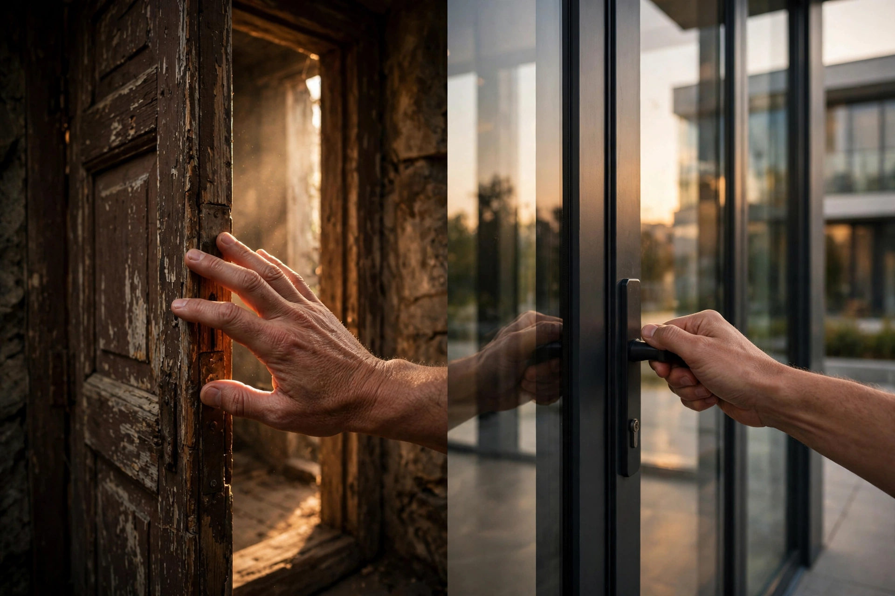

# 第 4 章：转场——镜头的标点符号

**地图定位**：时间 · 两个镜头之间怎么接。

为什么你的视频切来切去像 PPT？因为你把转场当特效用了。转场是标点符号——标点太多，句子就没法读了。

看这张图：左边一只手推开旧木门，右边一只手关上现代玻璃门——两个动作形状呼应，一接起来，观众"丝滑"地从一个时空滑到另一个时空。这叫匹配剪辑，是转场里最贵的"双关"。

## 转场是什么

**一句话**：两个镜头之间的连接方式。它决定观众"过门槛"时是 smooth 还是绊一跤。

**13 岁版**——四种常用转场，对应四种标点：

- **硬切（cut）**：直接切，最常用——句号。15 秒短视频里，90% 用它就够了。
- **淡入/淡出（fade）**：黑场过渡——省略号。"时间过去了""换了个地方"，睡觉/起床、昨天/今天。
- **闪白（flash）**：白闪一下——惊叹号。回忆、冲击、"叮！"的一下想起什么。
- **匹配剪辑（match cut）**：形状或动作接上——双关。开门→关门，转圈→转场，导演在炫技，观众在叫好。

**两个冷知识**：
1. 转场越"隐形"越高级。观众没注意到转场，说明接得好——注意到了，说明你在炫技（除非你就是要炫）。
2. 新手病：转场特效库全用一遍。旋转、翻页、碎裂……像在一句话里用了 10 种标点——导演看了摇头。

## 拿 15 秒短视频来说

15 秒里，硬切够用了。顶多在"回忆"处加一个闪白。记住：转场是标点，不是烟花——先把句子写顺，再谈修辞。

## Prompt 教学：AI 时代的转场思维

AI 一次生成一个镜头，转场发生在"剪辑"里，不在 prompt 里。但你可以在 prompt 里**为转场留接口**：

**范例（为匹配剪辑留接口）**：
- 镜头 A 中文：一只手推开一扇木门，暖光，2 秒
- 镜头 A English: A hand pushing open a wooden door, warm light, 2 seconds
- 镜头 B 中文：一只手关上一扇玻璃门，冷色调，2 秒，动作方向与 A 呼应
- 镜头 B English: A hand closing a glass door, cool tones, 2 seconds, motion mirroring shot A

**关键**：想玩匹配剪辑，两个镜头的"动作方向""构图位置"要呼应——生成时就想好怎么接，别等剪辑时再碰运气。

## 可复现实验

拍两个 2 秒镜头：A 是你推开门，B 是你关上门（动作方向一致）。硬切接起来看——是不是比随机两个镜头顺滑 10 倍？转场这章，一次实验就懂。

## 翻车预警

- **烟花翻车**：转场特效全开，观众看的是特效不是故事——删到只剩硬切，看看是不是更顺。
- **硬接翻车**：两个镜头情绪/方向完全断裂，硬切像撞墙——要么重拍一个过门槛，要么加个淡入当"省略号"。

## 作业：填空题（明天交）

"我的 15 秒短视频，镜头 2 到镜头 3 之间用____（硬切 / 淡入 / 闪白 / 匹配剪辑），因为____（情绪/时间/动作上发生了什么变化）。"

**示范**："我的 15 秒短视频，镜头 2 到镜头 3 之间用'闪白'，因为'猫突然想起小鱼干'——闪白就是'叮！'的一下。"

交：填好的句子。

## 后路

转场是标点：硬切是句号，淡入是省略号，闪白是惊叹号，匹配剪辑是双关。第 5 章，我们聊"声音"：画面的一半。
