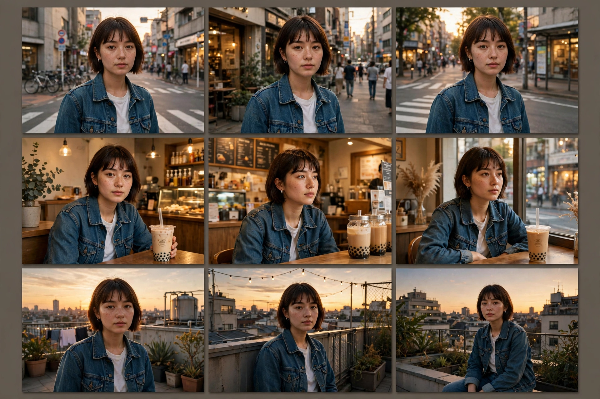

# 第 7 章：一致性——AI 时代最难的一课

**地图定位**：AI · 1000 帧里，同一张脸不能变。

这是全书最重要的一章。摄影师永远不用操心这个——按 1 次快门，脸不会变。但 AI 每生成一个镜头都是"重新画"，第 1 秒的女孩和第 10 秒的可能是两个人。观众一出戏，完播率就崩。

看这张图：九宫格里是同一个短发少女，同一件牛仔外套，出现在街道、奶茶店、天台——脸没变，衣服没变。这就是"一致性"：观众相信这是同一个人，故事才成立。

## 一致性是什么

**一句话**：角色、服装、场景、风格，在所有镜头里保持同一套。这是 AI 视频和真人拍摄最大的区别——真人拍摄天生一致，AI 生成天生不一致。

**13 岁版**——四个锁：

- **锁脸**：主角的脸。用同一张参考图（character reference），或同一段外貌描述，一字不差地复制到每个 prompt。
- **锁衣**：衣服。牛仔外套就是牛仔外套，不能第 3 个镜头变成卫衣——prompt 里写死。
- **锁场景**：奶茶店的装修风格。每个镜头都写"同一家奶茶店，木质吧台，暖黄灯"。
- **锁风格**：写实就是写实，不能一个镜头变水彩——prompt 开头永远先写风格。

**三个实战解法**：
1. **角色卡**：写一段固定的外貌描述（50 字），每个 prompt 原样粘贴——"短发少女，齐刘海，牛仔外套，白 T 恤"。这是第 1 章"角色卡 2.0"的实战版。
2. **参考图**：用第一张生成的图当参考，后续镜头都"照着这张生成"（图生视频 / 参考图模式）。
3. **分段生成**：一次只生成一个镜头，检查一致再生成下一个——别一次生成 8 个再返工。

**两个冷知识**：
1. 一致性 = 观众的信任。脸一变，观众出戏 3 秒——15 秒的片子，出戏 3 秒就是 20% 的完播率没了。
2. 先锁"脸和衣服"，再锁"场景和风格"——观众对"人变了"最敏感，对"墙的颜色变了"最迟钝。

## 拿 15 秒短视频来说

你的主角（你/你家猫/你的朋友），先定一张"定妆照"：脸、衣服、风格一次定死，后面 6 个镜头全部照着来。定妆照 = 你这条片子的"身份证"。

## Prompt 教学：角色卡怎么写

**范例（角色卡 + 两个镜头）**：

角色卡（每个 prompt 粘贴）：
- 中文：短发少女，齐刘海，牛仔外套，白 T 恤，写实风格
- English: Short-haired teenage girl, blunt bangs, denim jacket, white T-shirt, photorealistic style

镜头 1：
- 中文：[角色卡]走在黄昏的街道上，镜头跟随，3 秒
- English: [character card] walking on a street at dusk, camera following, 3 seconds

镜头 2：
- 中文：[角色卡]坐在奶茶店里喝珍珠奶茶，窗边，暖光，镜头缓慢推近，3 秒
- English: [character card] sitting in a bubble tea shop drinking bubble tea, by the window, warm light, camera slowly pushing in, 3 seconds

**关键**：角色卡一字不差——"牛仔外套"不能写成"牛仔衣"。AI 是"文字复印机"，你改一个字，它就可能换一张脸。

## 可复现实验

用同一个角色卡，生成 2 个不同场景的图（街道 / 奶茶店）。对比脸和衣服：变了还是没变？再试一次把角色卡改 2 个字——看看 AI 有多"听话"。

## 翻车预警

- **换脸翻车**：每个镜头都重写外貌描述，越写越飘——角色卡写一次，复制 100 次。
- **风格漂移翻车**：prompt 开头没写风格，第 4 个镜头突然变水彩——风格词永远放第一句。

## 作业：填空题（明天交）

"我的 15 秒短视频，主角是____（谁），角色卡是____（50 字外貌+服装+风格），我打算用____（角色卡复制 / 参考图 / 分段生成）来锁一致性。"

**示范**："我的 15 秒短视频，主角是我家猫，角色卡是'橘色虎斑猫，圆脸，脖子上有白色围脖，写实风格'，我打算用'参考图'来锁一致性——第一张图定死，后面照着生成。"

交：填好的句子 + 你的角色卡。

## 后路

一致性是 AI 时代导演的"内功"：锁脸、锁衣、锁场景、锁风格，角色卡一字不差。第 8 章，我们画分镜：导演的施工图。
