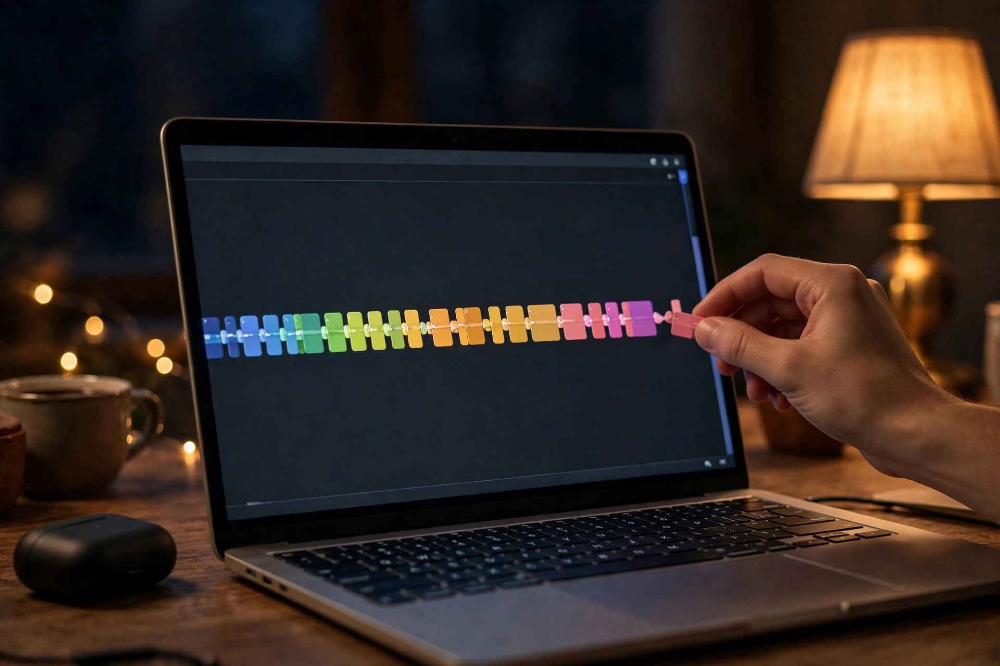

# 第 9 章：剪辑组装——把珠子串成链

**地图定位**：组装 · 按分镜组装，节奏检查三问。

分镜是散落的珠子，剪辑是线。线穿得不好，珠子再好看也是散的——"拍是拍了，故事讲不圆"，多半是组装时翻的车。

看这张图：时间线上彩色片段首尾相接排成一条链，一只手正把最后一个片段拼上。组装就是这个动作——按分镜表的顺序，一颗一颗穿。

## 剪辑组装是什么

**一句话**：按分镜表，把镜头（实拍或 AI 生成）按顺序拼起来，加转场、调节奏、配声音。

**13 岁版**——组装四步：

1. **按单抓药**：分镜表第 1 行 → 时间线第 1 个片段。顺序别错，错了故事就乱了。
2. **卡时长**：每个片段剪到分镜写的秒数（第 3 章的节奏模板：2–3 秒一切）。
3. **加标点**：转场（第 4 章）——90% 硬切，回忆处闪白，时间跳跃处淡入。
4. **配声音**：对白第 1 层，BGM 第 2 层，音效第 3 层（第 5 章的层级公式）。

**节奏检查三问**（组装完必问）：
1. 前 3 秒有钩子吗？（没有 → 重排）
2. 有没有哪个镜头可以删？（有 → 删，15 秒里没有"还行"的镜头）
3. 结尾 3 秒想分享吗？（不想 → 重想结尾）

**两个冷知识**：
1. 剪辑是"减法艺术"。好导演不是会加，是会删——15 秒里删掉 1 个多余镜头，节奏立刻顺。
2. AI 生成的镜头，先检查一致性（第 7 章）再组装——脸变了的镜头，组装前就毙掉，别等成片再哭。

## 拿 15 秒短视频来说

你的 6 个镜头（分镜表）→ 时间线 6 个片段 → 按"2-2-3-2-3-3 秒"排 → 硬切 → BGM + 音效。组装完问三问，不过就返工——返工在剪辑台，比返工在拍摄场便宜 10 倍。

## Prompt 教学：组装阶段的"补拍 prompt"

组装时发现缺一个过门槛的镜头？写个补拍 prompt：

**范例（缺一个"从白天到夜晚"的过渡）**：
- 中文：同一条街道，白天渐变为夜晚，路灯一盏盏亮起，固定机位，延时感，2 秒，写实风格
- English: The same street transitioning from day to night, streetlights turning on one by one, static camera, timelapse feel, 2 seconds, photorealistic

**关键**：补拍 prompt 要写"同一条/同一个"——锚定前一个镜头的一致性（第 7 章），不然补拍的镜头像插播广告。

## 可复现实验

拿你手机里 3 段旧视频，按"钩子→发展→反转"重排，加个硬切和 BGM。对比原版：同样的珠子，换根线，是不是像换了条片子？

## 翻车预警

- **顺序翻车**：凭感觉排列，没按分镜表——故事线断了。分镜表是组装说明书，不是建议。
- **舍不得删翻车**：明明有个镜头多余，但"拍得挺好看"舍不得——15 秒里没有"挺好看"的废镜头，只有"必须有"的镜头。

## 作业：填空题（明天交）

"我的 15 秒短视频，组装顺序是____（几个镜头），节奏检查三问：第 1 问____（有/无钩子），第 2 问____（删了哪个镜头），第 3 问____（结尾想不想分享）。"

**示范**："我的 15 秒短视频，组装顺序是 6 个镜头，节奏检查三问：第 1 问有钩子（猫怼脸），第 2 问删了'猫睡觉'那个多余镜头，第 3 问结尾'猫换台'想分享——好笑。"

交：填好的句子。

## 后路

组装是把珠子串成链：按单抓药、卡时长、加标点、配声音，三问检查。第 10 章，翻车现场集中修。
