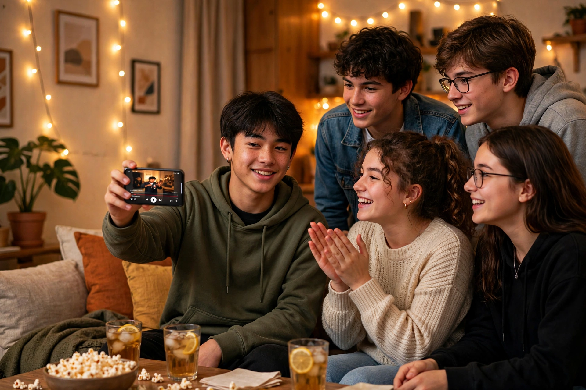

# 第 11 章：毕业作品——我的 15 秒短片

15 个决定学完了，12 个翻车修完了。现在，交付一条属于你的 15 秒短片——从分镜到成片，全流程走一遍。

## 任务：一条 15 秒的短片

选一个**你真正在乎的主题**（我家猫、滑板、奶茶店、夜跑、你最好的朋友……），走完导演全流程，交三样东西。

## 全流程清单（按顺序打勾）

- [ ] **1. 一句话故事**（第 6 章）：____。讲不清不开机。
- [ ] **2. 分镜表**（第 8 章）：5–8 行，每行：画面 + 运镜 + 时长 + 声音 + 故事功能。
- [ ] **3. 角色卡**（第 7 章）：主角外貌 50 字，一字不差，准备复制。
- [ ] **4. 生成/拍摄**：按分镜一行一个 prompt（或一个镜头），分段来，检查一致性。
- [ ] **5. 组装**（第 9 章）：按分镜顺序拼，卡时长，加标点，配声音。
- [ ] **6. 三问检查**：前 3 秒有钩子吗？有能删的镜头吗？结尾想分享吗？

## 导演手记模板（填空）

我的主题：____（比如：我家猫的复仇）

1. **运镜**：我用了____（推/跟/…），因为____
2. **节奏**：____个镜头，平均____秒一切，因为____
3. **转场**：主要用____，因为____
4. **声音**：对白____，BGM____，在第____秒____（骤停/静默），因为____
5. **故事**：钩子是____，反转是____
6. **一致性**：我的角色卡是"____"，用____（复制/参考图）锁住的
7. **最难的一步**：____，我是这么解决的：____

**示范**（节选）：我的主题是"我家猫的复仇"。运镜：开场用"推"，把观众拽进来……一致性：角色卡是"橘色虎斑猫，圆脸，白色围脖"，用参考图锁住的……最难的一步：猫第 3 个镜头脸变了，我是这么解决的：用第 1 张图当参考重生成的……

## 交作业：三样东西

- ① 成片（15 秒）
- ② 分镜表（5–8 行）
- ③ 导演手记（填完 7 个空）

交之前，对着第 1 章的地图自查：时间（运镜/节奏/转场）+ 声音 + 故事 + 一致性 + 组装——都填上了吗？

## 互评：三条评论法

看别人的片子，留三条：

1. **一个好**：哪个决定做得最到位（比如"第 12 秒音乐骤停，我屏住了呼吸"）
2. **一个问**：一个没看懂的地方（比如"第 2 个镜头是想表达什么？"）
3. **一个建议**："如果是我，我会试试____"

## 后路

交完这三样，你正式从青铜爬到白银。下一站是黄金：选一个类型（vlog？剧情？卡点？），拍 30 条——类型越窄，升级越快。

这本书的 15 个决定是地图，你的 30 条片子是路。去吧，导演。
