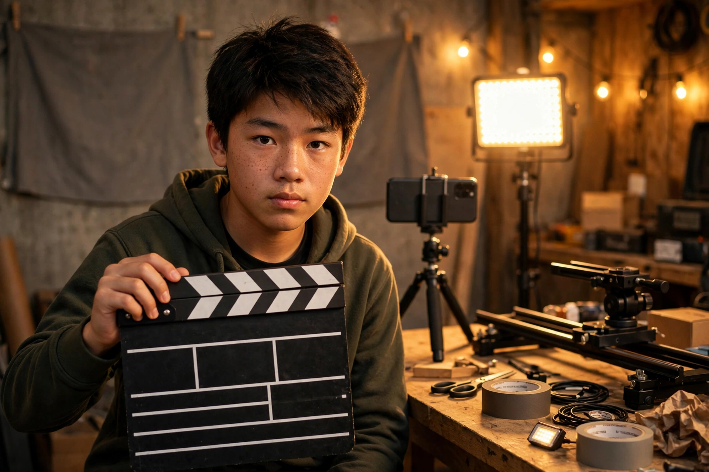

# 引言：先看一条 15 秒的片子

同一条素材，两种命运。

左边：随手拍的 15 秒——镜头晃，话没说完就切了，BGM 盖过了人声。你看了 3 秒，划走了。

右边：导演版的 15 秒——镜头慢慢推近，悬念在第 3 秒抛出来，音乐在反转处停半拍。你看完了，还点了赞。

素材一模一样。差的，是导演脑子里的 15 个决定。

这本书不教你买设备。你的手机 + 一个 AI，就是全部剧组。你要学的，是导演的那套"翻译"：把脑子里的故事，翻译成一个个镜头，再翻译成一句句能指挥 AI 的话。

## 这本书的规矩（沿用第一部）

1. **第一性原理开路**：照片 = 数光子；视频 = 24 张照片/秒 + 声音 + 故事。每章先回地图。
2. **统一例子**：一条 15 秒的短视频（你的 TikTok/抖音）——每章都在它身上试一遍。
3. **社交货币钩子**：每章回答"这能让我的视频更火吗"。
4. **课堂流程**：概念 → 图上指认 → Prompt 教学 → 实验 → 填空题 → 后路。
5. **每章一份填空题**：交一条分镜或一个镜头，不是写作文。
6. **AI 视频 Prompt 教学**：每章给 1–2 个 bilingual prompt 范例（中文 + English），直接能用。

## 和第一部的关系

这本书是《AI 摄影师：用文字拍照》的第二部。摄影的 8 个决定是地基——没学过的，先看第一部第 1 章（[站内直达](https://ezcat207.github.io/ai-photography/#c=01)）。本章凡是需要摄影知识的地方，会标：

> 📖 前置知识：《AI 摄影师》第 X 章 → [直达](https://ezcat207.github.io/ai-photography/#c=XX)

先看片子，再开地图。第 1 章，我们把 15 个决定一次装好。
